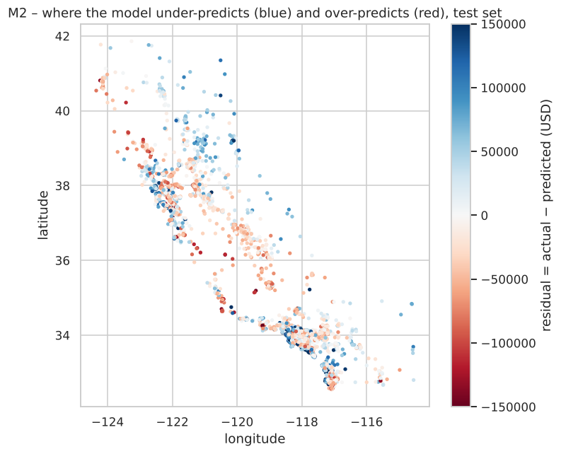

# California House Value Estimator

  

Explain and estimate the **median house value of a California neighbourhood** from census data, using multiple linear regression, and find out *why* the obvious model is not the best one to trust.

The project is built around a practical question: neighbourhood size features (rooms, bedrooms, population, households) all say almost the same thing, so a model that uses them all can score well while giving coefficients that are unstable and sometimes the wrong sign. The notebook measures that effect and fixes it.


*Test-set errors of the final model: blue = under-predicted, red = over-predicted. Errors cluster by region, which points to the next improvement: better location features.*

## Highlights
- **Real, public data:** 20,640 census block groups (1990), cleaned to 19,475 rows after handling missing values and capped targets.
- **Linear regression from scratch:** the normal equations are solved by hand on a small sample (design matrix, XᵀX, Xᵀy, inverse) and checked against scikit-learn.
- **Honest evaluation:** train/test split made before any exploration, model choice made by cross-validation on training data only, every model compared with a "predict the average" baseline.
- **Multicollinearity diagnosed and fixed:** variance inflation factors fall from 37 to 9.4 after combining count features into per-household ratios.
- **Failure analysis:** residuals by price band, residual map, heteroscedasticity test, and a list of what the model must not be used for.

## Results
Evaluated on 3,895 neighbourhoods the model never saw.

| Model | Features | MAE (USD) | RMSE (USD) | R² | Adjusted R² |
|---|---|---|---|---|---|
| Baseline: predict the training mean | 0 | 79,594 | 98,424 | 0.000 | 0.000 |
| Single feature (median income) | 1 | 56,826 | 74,280 | 0.430 | 0.430 |
| M1: all 8 raw features | 8 | 45,916 | 61,823 | 0.605 | 0.605 |
| **M2: 7 features, size counts combined into ratios** | 7 | 46,859 | 62,950 | 0.591 | 0.590 |

**What this says**
- Median income is by far the strongest single predictor; adding the other features cuts typical error by about \$12k.
- M1 is marginally more accurate, but its coefficients are unreliable (for example, `total_rooms` gets a negative effect even though bigger areas tend to be pricier). M2 gives up about \$1.1k of RMSE for coefficients that can be read and explained, so it is the recommended model.
- Training, cross-validated and test R² are all close, so the model is not overfitting; it is limited by being a straight-line model.

**Known weaknesses**
- Cheap areas are over-predicted and expensive ones under-predicted; error grows with price.
- Location enters as a straight line, but real prices follow coasts and cities. A few predictions come out negative.
- Rows are neighbourhood medians from 1990, not individual houses or current prices.

## How it works
1. **Frame** the question, target, inputs and success measure.
2. **Clean:** drop 207 rows with missing bedroom counts and 958 rows whose price is capped at \$500,001 (the true value is unknown, so keeping them would flatten the fitted slope).
3. **Split** 80/20 immediately, then explore only the training part.
4. **Explore:** distributions, scatter plots, correlation heatmap, price map.
5. **Hand-solve** the least-squares problem on 6 rows and verify with scikit-learn.
6. **Fit** baseline, single-feature, M1 and M2 models; compare with cross-validation.
7. **Diagnose:** VIF, residual plots, error by price band, geographic residuals, Breusch–Pagan test.
8. **Predict** a new neighbourhood, with a check that the inputs lie inside the training range.

## Data
| | |
|---|---|
| Dataset | California Housing, 1990 US Census, block-group level |
| Original paper | Pace, R. K. & Barry, R. (1997), *Sparse Spatial Autoregressions*, Statistics & Probability Letters 33(3) |
| Copy used | [ageron/handson-ml](https://github.com/ageron/handson-ml/tree/master/datasets/housing), saved as `data/housing.csv` |
| Row | One census block group; aggregate data with no personal information |
| Target | `median_house_value` (USD) |

## Quick start
```bash
git clone <this-repo-url>
cd <this-repo>
pip install -r requirements.txt
jupyter notebook Activity1_Multiple_Linear_Regression_California_Housing.ipynb
```
Run all cells top to bottom (fixed random seed 42). Tested with Python 3.12, scikit-learn 1.9, pandas 3.0, statsmodels 0.15.

## Project structure
```
.
├── Activity1_Multiple_Linear_Regression_California_Housing.ipynb   # full analysis, executed
├── manual_calculation_worksheet.md                                 # hand-solved normal equations
├── data/housing.csv
├── images/                                                         # saved figures
├── results/model_comparison.csv
└── requirements.txt
```


## Author
Built by [@DevyaniDhokrat](github.com/Devyani006).
